# Guide de la créatrice

Ce guide accompagne le quotidien de la Maison sur le site et dans l’Atelier, votre tableau de bord
privé. Chaque partie tient en quelques gestes, dans l’ordre où vous les faites.

Quelques repères avant de commencer.

**Le site** est ce que voient vos clientes. **L’Atelier** est votre espace privé : vous seule (et
les personnes que vous autorisez) pouvez y entrer. **Édition** est le mode qui vous permet de
modifier le site directement sur ses pages, depuis l’Atelier.

Dans ce guide, « Atelier › Commandes » veut dire : dans l’Atelier, cliquez sur **Commandes** dans le
menu. Les mots en gras sont ceux que vous lisez à l’écran.

Tant que les services de la Maison ne sont pas tous branchés (boutique Shopify, envoi des e-mails…),
le site fonctionne en démonstration : tout marche, mais les commandes et les e-mails sont simulés.
L’Atelier › **Réglages** dit ce qui est branché et ce qui manque.

> Les captures d’écran montrent le site de démonstration tel qu’il est aujourd’hui, avec des photos
> de pièces encore provisoires.

## Sommaire

1. [Entrer dans l’Atelier](#1-entrer-dans-latelier)
2. [Se repérer dans l’Atelier](#2-se-repérer-dans-latelier)
3. [Modifier un texte du site](#3-modifier-un-texte-du-site)
4. [Vérifier, publier, programmer, revenir en arrière](#4-vérifier-publier-programmer-revenir-en-arrière)
5. [Composer une page, créer une page](#5-composer-une-page-créer-une-page)
6. [Changer une photo, remplacer une photo provisoire](#6-changer-une-photo-remplacer-une-photo-provisoire)
7. [Les pièces, prix, délai, provisoire, Nouveau](#7-les-pièces-prix-délai-provisoire-nouveau)
8. [Suivre les commandes et faire avancer les étapes](#8-suivre-les-commandes-et-faire-avancer-les-étapes)
9. [Certificats et numéros de création](#9-certificats-et-numéros-de-création)
10. [Retours, échanges et factures](#10-retours-échanges-et-factures)
11. [Les avant-premières](#11-les-avant-premières)
12. [Les e-mails et leur aperçu](#12-les-e-mails-et-leur-aperçu)
13. [Les rendez-vous](#13-les-rendez-vous)
14. [Les validations demandées par les agents](#14-les-validations-demandées-par-les-agents)
15. [Les informations à compléter](#15-les-informations-à-compléter)
16. [En cas de doute](#16-en-cas-de-doute)

## 1. Entrer dans l’Atelier

L’Atelier a une adresse secrète. Aucun lien du site n’y mène et les moteurs de recherche ne la
connaissent pas. Elle vous est donnée à l’installation : gardez-la dans votre gestionnaire de mots
de passe, avec votre mot de passe.

### La première fois

1. Ouvrez l’adresse secrète de l’Atelier.
2. Écrivez votre **Adresse e-mail** et le mot de passe d’installation qui vous a été confié, puis
   **Continuer**.
3. Choisissez votre mot de passe personnel, d’au moins douze caractères. Une courte phrase se
   retient mieux qu’un mot compliqué. Écrivez-le deux fois, puis **Enregistrer et continuer**.
4. Installez la double authentification. Sur votre téléphone, ouvrez une application
   d’authentification (Apple Mots de passe, Google Authenticator ou 1Password) et scannez le code
   carré affiché à l’écran. L’application affiche alors un code à six chiffres qui change toutes
   les trente secondes. Écrivez-le dans **Code à six chiffres**, puis **Activer et entrer**.
5. L’Atelier vous donne huit **codes de secours**. Notez-les et rangez-les en lieu sûr : chacun
   ouvre l’Atelier une seule fois si votre téléphone n’est pas à portée de main. Ils ne seront plus
   affichés. Puis **J’ai noté mes codes, entrer**.

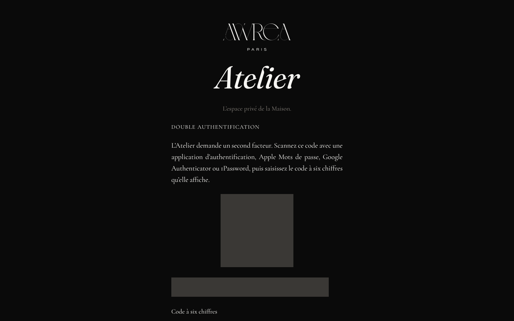

### Les fois suivantes

1. Ouvrez l’adresse secrète.
2. **Adresse e-mail**, **Mot de passe**, puis **Continuer**.
3. Le code à six chiffres de votre application (ou un code de secours), puis **Entrer**.

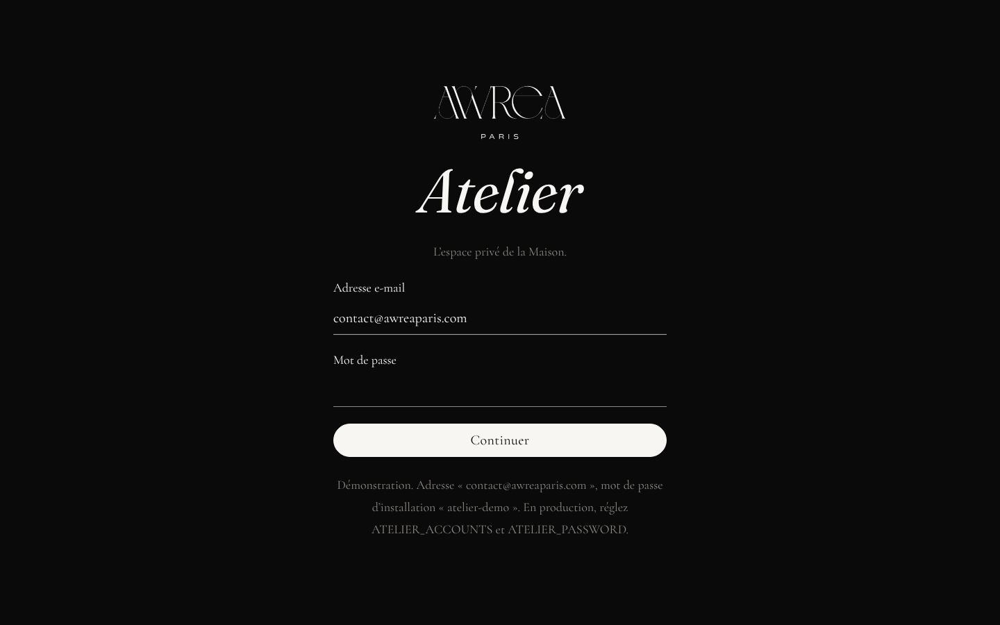

### Ce qui vous protège

Un e-mail vous prévient à chaque connexion. Si ce n’était pas vous, cliquez sur le lien « ce n’était
pas moi » de cet e-mail : toutes les sessions de l’Atelier se ferment, et votre compte est remis à
zéro. Il faudra alors entrer de nouveau avec le mot de passe d’installation, et faire changer ce mot
de passe par la personne qui s’occupe du site.

Après plusieurs essais manqués, l’accès se bloque une demi-heure et une alerte vous est envoyée.
C’est voulu.

Pour sortir : **Se déconnecter**, en bas du menu.

## 2. Se repérer dans l’Atelier

Le menu de gauche réunit tout. Voici à quoi sert chaque entrée.

| Entrée | Ce que vous y faites |
| --- | --- |
| **Vue d’ensemble** | Les ventes de la semaine et ce qui attend votre décision |
| **Validations** | Accepter ou refuser ce que les agents proposent (argent, gestes définitifs) |
| **Messages** | Les messages des clientes, avec une réponse préparée |
| **Catalogue** | Prix, délai de fabrication, « provisoire » et « Nouveau » de chaque pièce ; une nouvelle pièce |
| **Commandes** | Les commandes et leurs étapes, de « Commande reçue » à « Livrée » |
| **Rendez-vous** | Les rendez-vous à venir et vos disponibilités |
| **Retours** | Les retours et les échanges de taille |
| **Factures** | Les factures, les avoirs et l’export du mois |
| **Certificats** | Les certificats d’authenticité et leurs numéros de création |
| **Avant-premières** | Annoncer une collection avant son dévoilement |
| **Avis** | Les avis des clientes à publier ou non |
| **Clientes** | Les comptes des clientes |
| **Pages** | Toutes les pages du site, pour les modifier |
| **Photos** | Toutes les photos du site, avec la page où chacune paraît, et les photos provisoires à remplacer |
| **E-mails** | Tous les e-mails envoyés aux clientes, pour les modifier |
| **Contenus** | Les publications Instagram et les lettres préparées par l’agent Contenu |
| **SEO & IA** | La visibilité du site sur Google et auprès des assistants |
| **Rapports** | Les rapports des agents |
| **Équipe** | Le passage du matin de chaque rôle |
| **Journal des actions** | Tout ce que les agents ont fait, avec la date |
| **Réglages** | Les services branchés, ceux qui manquent, les connexions à l’Atelier |

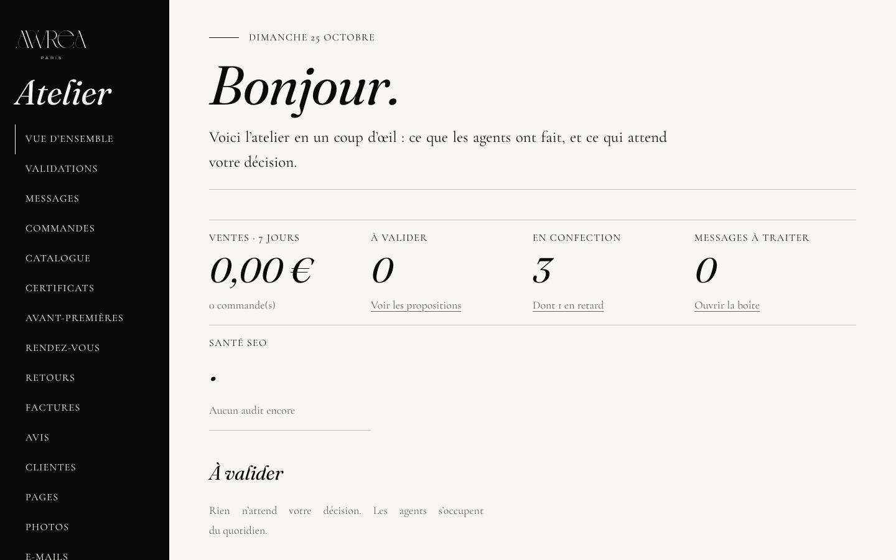

## 3. Modifier un texte du site

1. Atelier › **Pages**. Les pages sont rangées par famille : pages du site, pages créées, textes de
   l’interface (menu, boutons, messages), pages légales, e-mails.
2. Cliquez sur **Modifier** à côté de la page. Elle s’ouvre telle que vos clientes la voient, avec
   la barre **Édition** en bas de l’écran. Vous seule voyez cette barre.
3. Vérifiez que **Modifier** est choisi dans la barre (et non **Naviguer**, qui sert à passer d’une
   page à l’autre sans rien changer).
4. Cliquez sur un titre ou un paragraphe. Un petit panneau s’ouvre : écrivez votre texte.
5. Le panneau compte les caractères et signale ce qui peut s’améliorer (un tiret, une formule toute
   faite, une apostrophe droite). Il propose, vous gardez le dernier mot : **Corriger la
   typographie** applique la correction, **Garder tel quel** garde votre texte.
6. Sous votre texte, la case **Version anglaise** reçoit la traduction. Laissée vide, le français
   s’affiche à la place.
7. **Enregistrer**. Votre texte part en brouillon : vos clientes ne voient rien tant que vous
   n’avez pas appuyé sur **Publier** (partie 4).

Les mots entre accolades, comme {prenom} ou {delai}, sont remplacés automatiquement au moment de
l’affichage : gardez-les tels quels.

Les textes officiels que vous avez écrits (À propos, texte de la collection, présentation de la
Maison, conditions générales de vente, mentions légales) sont repris mot pour mot. Le panneau n’y
signale que la typographie.

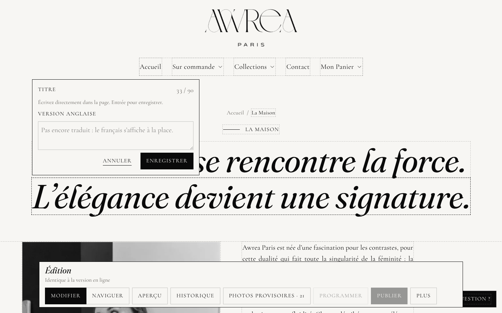

## 4. Vérifier, publier, programmer, revenir en arrière

Tous ces boutons sont dans la barre **Édition**, en bas de la page.

**Aperçu** montre la page sur téléphone, tablette et ordinateur, avec vos changements.

**Publier** met la page en ligne tout de suite, avec tous vos changements.

**Programmer** choisit le jour et l’heure, à l’heure de Paris. La page passe en ligne toute seule
au moment choisi (au quart d’heure près). D’ici là, vous pouvez encore la modifier. Les publications
prévues sont listées dans Atelier › **Pages**, sous **Publications programmées**, avec un bouton
**Annuler**.

**Historique** garde chaque version publiée. Choisissez une version, puis **Remettre en ligne** :
elle revient sur le site, et celle d’aujourd’hui reste dans l’historique. Rien ne se perd.

**Plus** › **Effacer les modifications** jette le brouillon : la page en ligne ne change pas.

**Plus** › **Aide** relance le petit guide de l’édition. **Plus** › **Retour à l’Atelier** ou
**Quitter l’édition** pour sortir.

Dans Atelier › **Pages**, la colonne **État** dit pour chaque page : **En ligne**, **Modifiée, pas
encore en ligne** (un brouillon attend) ou **Brouillon** (page jamais publiée).

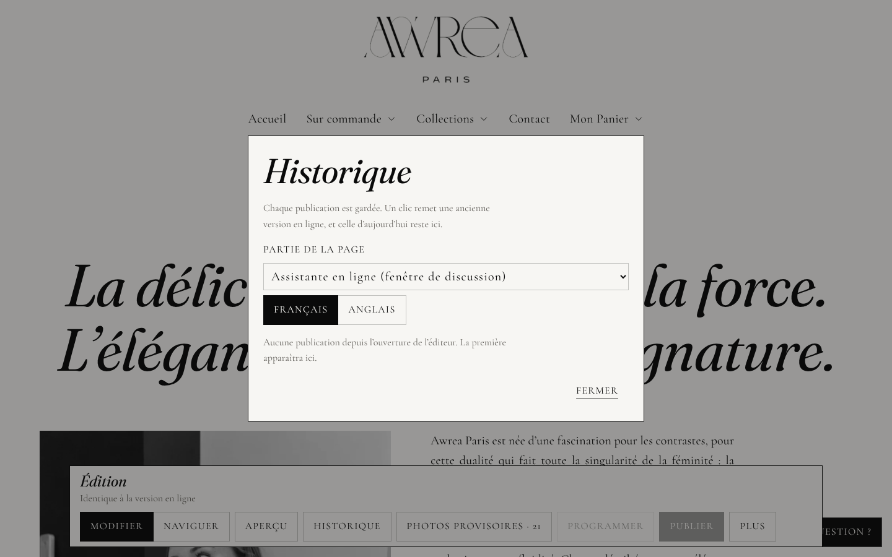

## 5. Composer une page, créer une page

### Composer

En mode Édition, passez la souris sur une section : de petits boutons apparaissent. **Monter**,
**Descendre**, **Dupliquer**, **Supprimer**, **Ajouter une section après**. La bibliothèque ne
propose que des sections dessinées pour la Maison : la mise en page reste toujours juste.

### Créer une page

1. Atelier › **Pages**, rubrique **Nouvelle page**.
2. Choisissez un **Modèle** : un événement, un article du Journal ou une collection.
3. Donnez un **Titre** ; l’**Adresse** de la page se propose toute seule.
4. **Créer la page en brouillon**. La page s’ouvre en mode Édition, avec des repères entre crochets
   à remplacer par vos textes et vos photos. Tant qu’il en reste un, elle ne peut pas être publiée.
5. Publiez quand elle est prête (partie 4).

Une page que vous avez créée se supprime depuis Atelier › **Pages** › **Supprimer**. Attention, la
suppression est définitive : la page disparaît du site et de l’historique.

## 6. Changer une photo, remplacer une photo provisoire

### Changer une photo d’une page

1. Ouvrez la page en mode Édition (partie 3).
2. Glissez une photo depuis votre ordinateur sur l’image à remplacer. Ou cliquez sur l’image, puis
   **Choisir une photo**. **Photos déjà déposées** reprend une photo envoyée auparavant.
3. La photo est allégée et déclinée en plusieurs tailles. Cliquez sur la partie de la photo qui doit
   toujours rester visible quand l’écran la recadre (un visage, un détail de dentelle).
4. Remplissez **Description pour les personnes qui ne voient pas la photo** : la pièce, ce qu’on
   voit de la matière, la pose, le fond. Une proposition est faite, à corriger si besoin.
5. **Enregistrer**, puis **Publier** (partie 4).

### Les photos provisoires

En attendant les vraies prises de vue, les pièces sont présentées avec des images générées. Elles
sont marquées « provisoire » et portent sur le site une mention discrète « visuel provisoire ».
Le but est de les remplacer toutes, une à une, dès que vos photos existent.

1. En mode Édition, chaque photo provisoire porte une pastille **Provisoire**.
2. La liste **Photos provisoires à remplacer** les rassemble toutes, avec la page où chacune
   paraît : bouton **Photos provisoires** de la barre d’édition, ou Atelier › **Photos**, filtre
   **Photos provisoires à remplacer** (aussi depuis Atelier › **Pages**).
3. Remplacez la photo comme ci-dessus. Une photo que vous envoyez n’est plus provisoire : la
   mention disparaît du site à la publication.
4. La case **photo provisoire** reste à votre main : cochez-la si la nouvelle photo est elle aussi
   provisoire, décochez-la si une photo déjà en place est en fait définitive.

> Le détail, pas à pas, est dans `docs/EDITEUR.md`, partie « Photos provisoires ». Les photos
> des pièces et des collections se remplacent dans Shopify (ci-dessous).

### Les photos des pièces

Les photos de la fiche d’une pièce viennent de la boutique. Une fois la boutique Shopify branchée :

1. Dans Shopify, **Produits**, ouvrez la pièce.
2. Dans **Médias**, ajoutez vos photos et retirez les visuels provisoires. La première photo est
   celle des cartes de la boutique.
3. Dans les métachamps de la pièce, passez **visuels provisoires** à faux : la mention « visuel
   provisoire » disparaît de la fiche.

Le site se met à jour tout seul quelques instants après. Le détail est dans `ACTIVATION.md`,
étape 4.2.

L’Atelier ne permet pas de remplacer les photos d’une pièce déjà en ligne : cela se fait dans
Shopify, comme ci-dessus. Dans Atelier › **Photos**, chaque photo provisoire d’une pièce le
rappelle. Tant que la boutique n’est pas branchée, confiez vos photos à la personne qui s’occupe du
site. Seule une nouvelle pièce reçoit ses photos depuis l’Atelier (partie 7).

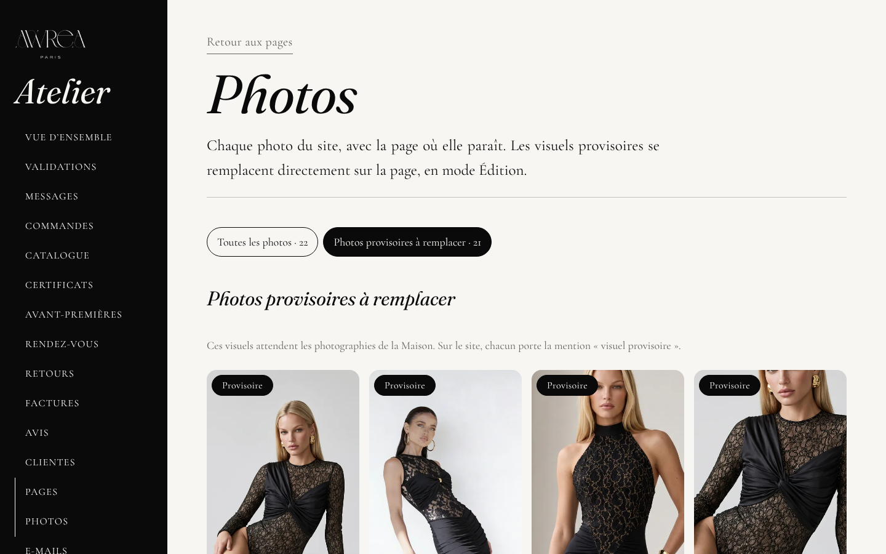

## 7. Les pièces, prix, délai, provisoire, Nouveau

Chaque pièce est créée sur demande, sans stock : elle se commande toujours, dans toutes ses
tailles. Sa fiche affiche son délai de fabrication. Il n’y a donc aucun stock à tenir.

1. Atelier › **Catalogue**. Une ligne par pièce.
2. **Prix** : le montant en euros, par exemple 70,00.
3. **Délai de fabrication** : de tant à tant de semaines, par exemple 2 à 3.
4. **provisoire**, sous le prix ou sous le délai : cochée, la valeur est signalée comme à confirmer.
   En haut de la page, l’Atelier rappelle les prix et les délais encore à confirmer. Une fois une
   valeur confirmée, décochez la case.
5. **Nouveau** : cochée, la pièce porte la pastille noire « Nouveau » sur sa carte.
6. **Enregistrer**, au bout de la ligne. Le changement s’affiche aussitôt sur le site (et dans
   Shopify quand la boutique est branchée).

Aujourd’hui, les prix de la robe Sienna, du body Gaïa, du top Evina et du top Kira sont provisoires,
ainsi que tous les délais (bodys et tops 2 à 3 semaines, robes 3 à 4 semaines).

Si les tailles d’une pièce n’ont pas toutes le même prix dans Shopify, le prix se règle dans
Shopify : l’Atelier vous le dit sur la ligne de la pièce.

### Ajouter une nouvelle pièce

Rubrique **Nouvelle pièce**, en bas de la page Catalogue : déposez jusqu’à huit photos, choisissez
la catégorie, la collection, le prix, le délai, les tailles, et écrivez quelques notes. **Rédiger
et publier la fiche** : l’agent Catalogue rédige la fiche et la met en ligne. Relisez-la ensuite sur
le site. Les matières, la composition et l’entretien que vous n’avez pas donnés restent « À
COMPLÉTER » (partie 15).

L’agent Catalogue n’invente jamais une matière ni un conseil d’entretien. S’ils ne sont pas dans
**Vos notes**, la fiche affiche à leur place deux repères, dans la rubrique **Matières et
entretien** : « [À COMPLÉTER : composition exacte des matières, communiquée par la Maison] » et
« [À COMPLÉTER : conseils d’entretien] ». Sous le bouton, un message dit combien de points restent à
confirmer, et Atelier › **Journal des actions** les nomme.

Pour faire le point plus tard : Atelier › **Vue d’ensemble**, rubrique **L’équipe**, agent
Catalogue, **Faire le bilan**. Le Journal des actions liste alors, pièce par pièce, ce qui manque
encore : composition, entretien, taille portée par le mannequin.

Tant que l’assistante n’est pas branchée (`ACTIVATION.md`, étape 8), la fiche suit un modèle : les
matières et l’entretien restent à compléter, même s’ils sont dans vos notes. Si une tournure du
texte est à revoir, la fiche vous attend d’abord dans Atelier › **Validations**.

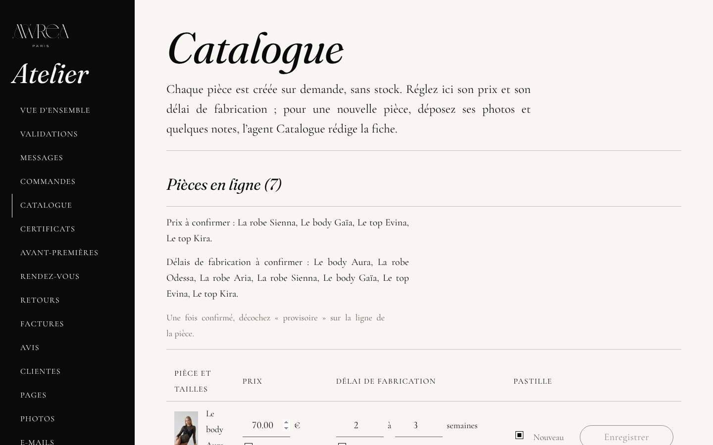

## 8. Suivre les commandes et faire avancer les étapes

Une commande passe par cinq étapes. Votre cliente les voit dans son compte, ou sur la page
**Suivre ma commande** du site avec son numéro de commande et son adresse e-mail. Elle reçoit un
e-mail à chaque étape.

| Étape | Ce qu’elle veut dire | Qui la déclenche |
| --- | --- | --- |
| **Commande reçue** | Le paiement est confirmé | Toute seule, au paiement |
| **En confection** | Les artisans travaillent la pièce | Vous, **Passer en confection** |
| **Prête** | La pièce est terminée | Vous, **Marquer comme prête** |
| **Expédiée** | Le colis est parti | Vous, **Marquer comme expédiée** |
| **Livrée** | Le colis est arrivé | Vous, **Marquer comme livrée** (ou toute seule, voir plus bas) |

### Faire avancer une commande

1. Atelier › **Commandes**. En haut, **En retard sur le délai annoncé** liste les commandes dont la
   confection dépasse le délai promis à la cliente. Un mot de votre part la rassurera.
2. Dans **Dernières commandes**, chaque ligne montre l’étape, la **Fin de confection prévue** et le
   bouton de l’**Étape suivante**. Un clic suffit pour **Passer en confection** ou **Marquer comme
   prête**.
3. Pour l’expédition, cliquez sur **Expédier** : la fiche de la commande s’ouvre. Choisissez le
   **Transporteur**, collez le **Numéro de suivi** (facultatif, mais votre cliente pourra suivre son
   colis), puis **Marquer comme expédiée**. Le site vous demande de confirmer, car la cliente reçoit
   aussitôt l’e-mail d’expédition.
4. À l’arrivée du colis : **Marquer comme livrée**.

Sur la fiche d’une commande, vous trouvez aussi la frise des étapes telle que la cliente la voit,
l’adresse de livraison, les options cadeau, **Imprimer le bon de livraison**, **Facture** et
**Certificats**.

### Quand la boutique Shopify est branchée

Le paiement arrive de Shopify : la commande apparaît toute seule en **Commande reçue**. Les étapes
**En confection** et **Prête** se donnent toujours depuis l’Atelier. L’expédition se déclare dans
Shopify, en ouvrant la commande et en indiquant le numéro de suivi : le site suit seul et passe la
commande en **Expédiée**, puis en **Livrée** quand Shopify reçoit la livraison. L’Atelier vous le
rappelle par la mention **Dans Shopify**.

### Les e-mails de chaque étape

Chaque étape envoie aussitôt son e-mail à la cliente, une seule fois. **Commande reçue** part au
paiement, avec le détail des pièces, le lien de chaque certificat et la facture. Viennent ensuite
**En confection**, **Prête** et **Expédiée** ; l’e-mail d’expédition donne le lien de suivi du colis
quand le numéro est connu. À l’étape **Livrée**, la cliente reçoit « Votre pièce est arrivée ». Deux
jours plus tard, elle reçoit un mot sur l’entretien de sa pièce, puis, deux semaines après la
livraison, une invitation à donner son avis.

Les étapes se suivent dans l’ordre : aucune ne peut être sautée. Si un e-mail ne part pas, l’étape
reste enregistrée et l’Atelier vous le dit.

Avec la boutique Shopify, la confirmation de commande que reçoit la cliente est celle de Shopify.
Une commande expédiée reste **Expédiée** tant que Shopify n’a pas enregistré la livraison du colis :
l’Atelier n’a pas de bouton pour la passer à la main en **Livrée**.

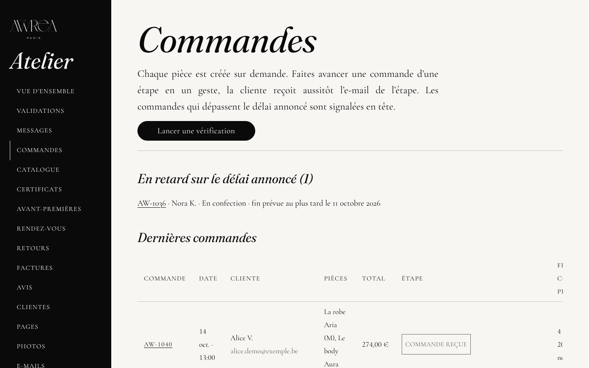

## 9. Certificats et numéros de création

Chaque pièce commandée reçoit un certificat d’authenticité numérique et un **numéro de création**.
C’est le numéro d’ordre de la Maison : la première pièce commandée porte « Création n° 0001 »,
la suivante « Création n° 0002 », et ainsi de suite. Il n’est jamais donné deux fois et ne revient
jamais à zéro. Il s’attribue tout seul : vous n’avez rien à choisir.

Le certificat porte aussi un **code** de vérification (il commence par « AW ») et un code carré à
scanner (QR code), qui mène à la page publique du certificat.

1. Atelier › **Certificats**, ou depuis une commande, **Certificats**.
2. La liste montre pour chaque pièce son code, la pièce, sa **Création** (son numéro), la commande,
   la date de confection et si la cliente l’a rattaché à son compte.
3. **Préparer** ouvre le certificat. Vérifiez la date **Confectionnée le** (posée le jour où la
   pièce est prête), écrivez si vous le souhaitez un **Mot de la créatrice** (laissé vide, le
   certificat porte votre phrase habituelle), puis **Enregistrer**.
4. **Imprimer** : une même feuille donne le certificat à glisser dans le paquet et l’étiquette à
   coudre dans la pièce (code carré, numéro de création, code).

Votre cliente reçoit le lien de son certificat et un code personnel pour le rattacher à son compte.

Le numéro de création s’imprime en grand sur le certificat, sous le nom de la pièce (« Création
n° 0001 »), et sur l’étiquette à coudre, entre le nom de la pièce et le code. Il se lit aussi dans
le code : dans AW-AUR-0001-94VL, 0001 est le numéro de création. Il est donné à la commande et ne se
modifie jamais, même depuis l’Atelier : seuls la date et votre mot se corrigent. Le numéro d’une
commande annulée n’est pas redonné.

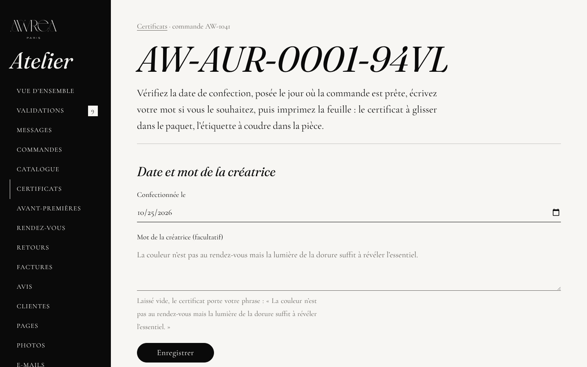

## 10. Retours, échanges et factures

### Les retours et les échanges

Vos clientes demandent leur retour ou leur échange de taille en ligne, et reçoivent leur étiquette.

1. Atelier › **Retours**. Chaque demande montre la pièce, la taille, le motif et ce que la cliente
   souhaite.
2. À l’arrivée du colis : **Colis reçu**.
3. Pour un remboursement : **Rembourser** (le montant est écrit sur le bouton). Le site vous demande
   de confirmer, et l’avoir est émis tout seul.
4. Pour un échange : **Expédier la nouvelle taille**.
5. Si la pièce revient portée ou sans son certificat : **Refuser**. La cliente est prévenue par
   e-mail.

Les conditions de retour sont celles de vos conditions générales de vente.

Chaque pièce étant créée sur demande, la nouvelle taille d’un échange n’attend pas en stock : elle
est confectionnée pour la cliente, avec son délai de fabrication. La page **Questions fréquentes**
du site le lui annonce. Lancez sa confection quand vous le souhaitez, dès la demande ou à l’arrivée
du colis. L’Atelier ne suit pas cette confection étape par étape, comme pour une commande.

Appuyez sur **Expédier la nouvelle taille** seulement quand la pièce part : la cliente reçoit
aussitôt l’e-mail « Votre nouvelle taille est en route ». Cet e-mail lui promet le lien de suivi,
mais l’Atelier ne demande pas de numéro de suivi pour un échange : envoyez-lui ce numéro depuis
votre boîte e-mail habituelle. Un échange ne déplace aucun argent.

### Les factures

Atelier › **Factures**. Chaque paiement donne sa facture, chaque remboursement son avoir, numérotés
dans l’ordre et conservés dix ans. Un bouton par mois télécharge l’export pour la comptabilité ;
l’export du mois part aussi tout seul le 1er. La facture d’une commande s’ouvre aussi depuis sa fiche,
bouton **Facture**.

## 11. Les avant-premières

Une avant-première annonce une collection sur la page **Bientôt** du site, avant son dévoilement à
toutes. Elle se dit par ses dates, écrites en toutes lettres : jamais de compte à rebours, jamais de
quantité. Une pièce créée sur demande ne manque jamais.

1. Atelier › **Avant-premières**.
2. Rubrique **Annoncer une collection** : **Nom de la collection**, **Adresse de la page**, **Texte
   de présentation** (une ligne vide sépare deux paragraphes), **Images** (sans image, les photos des
   pièces choisies s’affichent).
3. Les dates, à l’heure de Paris : **Avant-première des inscrites** (le jour où les inscrites à la
   lettre peuvent commander) et **Dévoilement à toutes**.
4. **Pièces de la collection** : cochez-les. Elles quittent la boutique jusqu’au dévoilement et se
   commandent en avant-première.
5. Si vous le souhaitez, cochez **Écrire aux inscrites à la lettre de la Maison** : chacune reçoit
   son lien personnel vers l’avant-première, une seule fois pour cette collection.
6. Ou cochez **Présentation privée** et choisissez un mot de passe : jusqu’au dévoilement, la
   collection est réservée aux personnes qui ont ce mot de passe.
7. **Annoncer la collection**.

La liste **Collections annoncées** montre l’état de chacune (**Annoncée**, **Avant-première en
cours**, **Dévoilée**), ses dates, le nombre d’inscrites, et les liens **Voir la page** et
**Modifier**.

La lettre aux inscrites part dès que vous appuyez sur **Annoncer la collection**, ou sur
**Enregistrer les modifications** si vous cochez la case plus tard. Chaque inscrite reçoit cette
lettre une seule fois pour cette collection, avec son lien personnel. Une personne qui s’inscrit à
la lettre après l’annonce reçoit la sienne le matin suivant, jusqu’au dévoilement. Aucune lettre ne
part pour une présentation privée, ni après le dévoilement. Dans la liste, sous le nom de la
collection, l’Atelier écrit « Lettre aux inscrites prévue », puis le nombre de lettres envoyées.

La colonne **Inscrites sur la page** compte les personnes qui ont laissé leur adresse sur la page de
la collection : chacune reçoit aussitôt son lien personnel.

Quelques repères sur le formulaire. Le champ **Images** attend l’adresse de chaque image, une par
ligne (par exemple /media/img/odessa-1). Le plus simple est de le laisser vide : les photos des
pièces cochées s’affichent alors. L’avant-première doit précéder le dévoilement, sinon l’Atelier
vous le signale. Quand **Présentation privée** est cochée, la case de la lettre disparaît, la
première date devient **Présentation privée** et le mot de passe compte au moins six caractères.
L’adresse de la page ne se change plus une fois la collection annoncée. Pour revenir sur une
collection : **Modifier**, puis **Enregistrer les modifications**. Laissé vide, le mot de passe
reste le même.

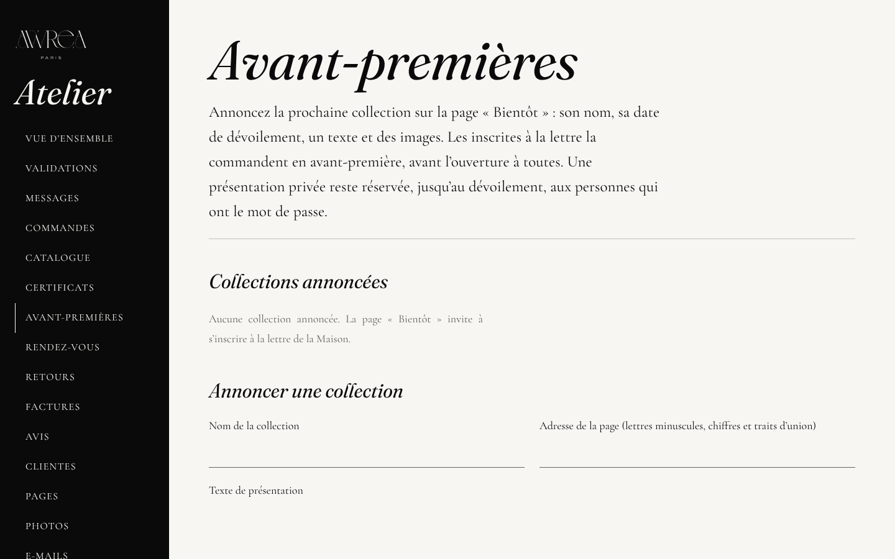

## 12. Les e-mails et leur aperçu

Tous les e-mails envoyés à vos clientes se modifient comme une page : confirmation de commande,
étapes de la commande, rendez-vous, lettres.

1. Atelier › **E-mails**. Chaque e-mail s’y montre tel qu’il arrive dans la boîte de vos clientes.
   Ils sont rangés en deux familles : **Service** (les commandes, les rendez-vous) et **Lettres**.
2. **Modifier l’e-mail** : l’**Objet**, la **Ligne d’aperçu** (la phrase qui s’affiche sous l’objet
   dans la boîte de réception), puis les blocs : en-tête, photographie, texte, pièce, bouton,
   signature, pied de page. Glissez un bloc pour le déplacer, ou utilisez **Monter le bloc** et
   **Descendre le bloc**.
3. À droite, l’aperçu : choisissez la **Messagerie** (Apple Mail, Gmail, Outlook), l’**Écran**
   (ordinateur ou téléphone) et le **Thème** (clair ou sombre). **Essayer un cas** montre l’e-mail
   avec un exemple de commande ou de cliente.
4. **M’envoyer un essai** vous l’envoie, pour le voir dans votre propre boîte.
5. Le brouillon s’enregistre tout seul. Rien ne part avant **Publier** : les prochains envois partent
   avec cette version. **Historique** pour revenir à une version précédente.

Les mots entre accolades ({prenom}, {numero}…) sont remplacés à l’envoi : gardez les accolades.

**Textes communs**, en bas de la page E-mails : la devise, la ligne sous la devise, les mentions de
la Maison, le lien de désinscription, repris en bas de chaque e-mail.

Pour un service d’envoi (Brevo ou Klaviyo) : dans l’e-mail, **Pour Brevo** ou **Pour Klaviyo**
télécharge le gabarit à importer (`ACTIVATION.md`, étape 14). Sur les e-mails des étapes de commande,
**Pour Shopify** télécharge aussi le gabarit des notifications de Shopify.

Les e-mails des étapes de commande sont dans la famille **Service** : **Commande reçue**, **Commande
en confection**, **Commande prête** et **Commande expédiée**. Sous chaque aperçu, une phrase dit
quand il part. Avec la boutique Shopify, la confirmation de commande est celle de Shopify :
**Commande reçue** ne part plus. Les e-mails qui suivent la livraison (« Votre pièce est arrivée »,
l’entretien, la demande d’avis) ne sont pas dans la liste : pour l’instant, leur texte ne se modifie
pas depuis l’Atelier.

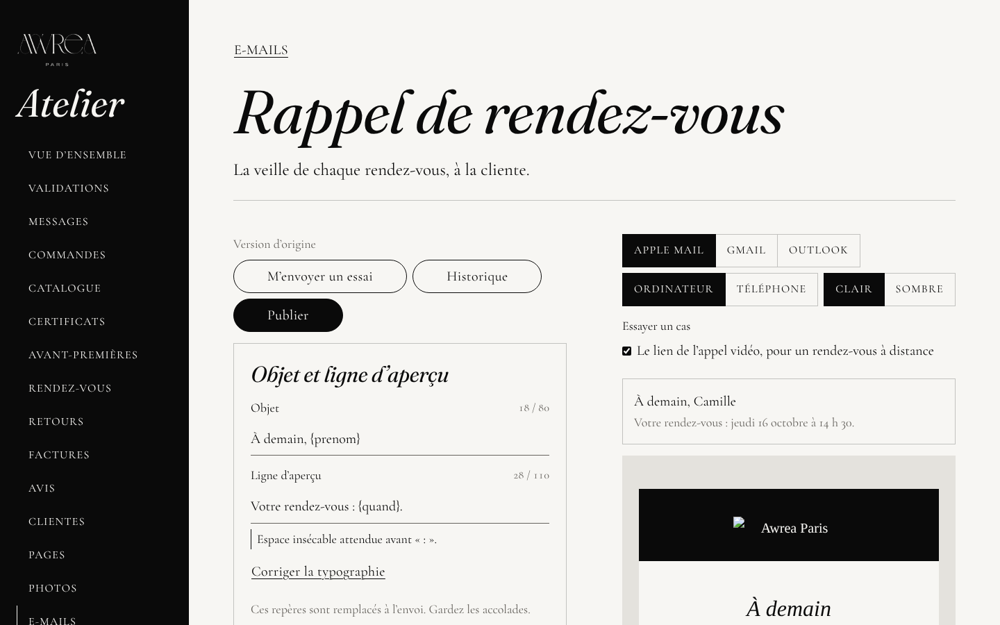

## 13. Les rendez-vous

Vos clientes réservent elles-mêmes sur la page **Prendre rendez-vous** du site : un essayage, un
appel vidéo avec vous ou un premier rendez-vous sur mesure, dans les moments que vous ouvrez.

1. Atelier › **Rendez-vous**. **À venir** liste les rendez-vous, avec la cliente et l’heure.
   **Annuler** libère le moment : la cliente est prévenue et invitée à en choisir un autre.
2. **Disponibilités** : les **Jours ouverts aux rendez-vous**, l’heure du **Premier rendez-vous** et
   la **Fin de journée**, l’intervalle entre deux débuts de rendez-vous, la **Prévenance** (combien
   d’heures à l’avance une cliente peut réserver), la limite **Réservable jusqu’à**, et les **Jours
   fermés** (un par ligne). Puis **Enregistrer les disponibilités**.
3. **Dans votre agenda** › **Copier l’adresse de l’agenda** : ajoutez cette adresse à l’agenda de
   votre téléphone, chaque rendez-vous y apparaît.

Chaque cliente reçoit une confirmation avec l’invitation pour son agenda, puis un rappel la veille.
Ces e-mails se modifient dans Atelier › **E-mails**.

## 14. Les validations demandées par les agents

Des agents s’occupent chaque jour de la gestion courante : messages, commandes en confection,
retours, comptabilité, rendez-vous, sauvegarde… Ils préviennent et préparent. Tout ce qui touche à
l’argent ou ne se défait pas vous est toujours demandé.

1. Atelier › **Validations**. **En attente** liste les propositions : un changement de prix, un
   remboursement, une annulation de commande, la suppression d’une pièce, une lettre à toute la
   liste. Chacune dit ce qui sera fait.
2. **Valider** exécute la proposition. **Refuser** l’écarte.
3. **Historique**, plus bas, garde vos décisions.

Atelier › **Équipe** montre le passage du matin de chaque rôle : ce qu’il a vu, ce qui vous attend.
Le Contrôle relit chaque passage. Atelier › **Journal des actions** garde tout ce que les agents ont
fait, avec la date.

Les agents n’ont jamais accès aux données bancaires ni aux mots de passe.

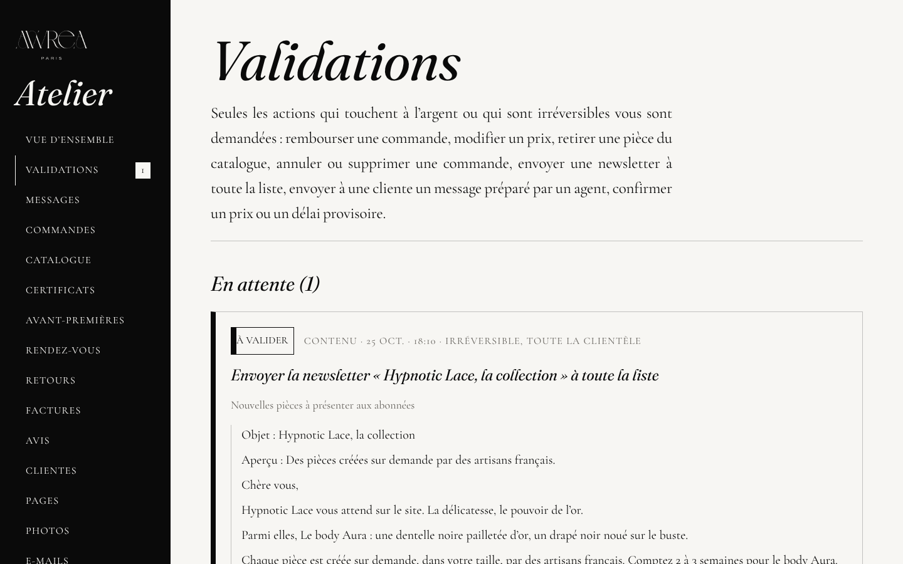

## 15. Les informations à compléter

Le site n’invente rien sur la Maison. Quand une information manque, elle s’affiche sous la forme
d’un repère bien visible, par exemple « [À COMPLÉTER : numéro de TVA intracommunautaire] ».

**Où les voir.** Sur les pages légales du site (mentions légales, confidentialité, propriété
intellectuelle), et sur les fiches des pièces pour les matières, la composition, l’entretien et les
mesures. Dans Atelier › **Pages**, la famille **Pages légales** les rappelle. Chaque matin, le
Gardien de l’éditeur (Atelier › **Équipe**) signale les textes encore entre crochets.

**La liste complète** est dans le fichier `LEGAL-A-COMPLETER.md`. Aujourd’hui, onze informations y
attendent, notamment : le numéro de TVA (ou la mention de la franchise de TVA), la directrice de la
publication, le médiateur de la consommation, l’hébergeur du nouveau site, le numéro
d’enregistrement de la marque, les crédits des photographes, la durée de conservation des demandes
sans suite. S’y ajoutent les éléments listés dans `RESSOURCES.md` : vos vraies photos, le logo en
SVG, la licence de la police du logo, le crédit de votre portrait, les prix et délais définitifs,
les matières et l’entretien de chaque pièce.

**Comment les remplir.**

1. Les informations légales : envoyez-les à la personne qui s’occupe du site. Elle les inscrit dans
   le registre légal (`content/legal/fields.ts`), et le repère disparaît partout d’un coup.
2. Les matières, la composition et l’entretien d’une pièce : avec la boutique Shopify, dans la fiche
   de la pièce (**Produits**, la pièce, métachamps « matières » et « entretien ») ; sinon, envoyez-les
   à la personne qui s’occupe du site.
3. Les repères entre crochets d’une page que vous avez créée : remplacez-les en mode Édition
   (partie 3).

Pour l’instant, l’Atelier ne permet de remplir ni les matières ni l’entretien d’une pièce déjà en
ligne : la page **Catalogue** ne règle que le prix, le délai et les cases « provisoire » et
« Nouveau ». Passez par Shopify ou par la personne qui s’occupe du site (point 2). Pour une nouvelle
pièce, écrivez-les dès le départ dans **Vos notes** : une fois l’assistante branchée, l’agent
Catalogue les reprend sur la fiche (partie 7).

## 16. En cas de doute

Rien ne part en ligne sans **Publier**, et tout se défait par l’**Historique**.

Le site ne tombe jamais faute d’un service : il passe en démonstration, et Atelier › **Réglages**
dit ce qui manque.

Brancher un service (Shopify, l’envoi des e-mails, l’assistante…) se fait sans toucher au code :
`ACTIVATION.md` donne chaque étape, dans l’ordre.

Un geste qui touche à l’argent ou qui est définitif vous demande toujours une confirmation.
